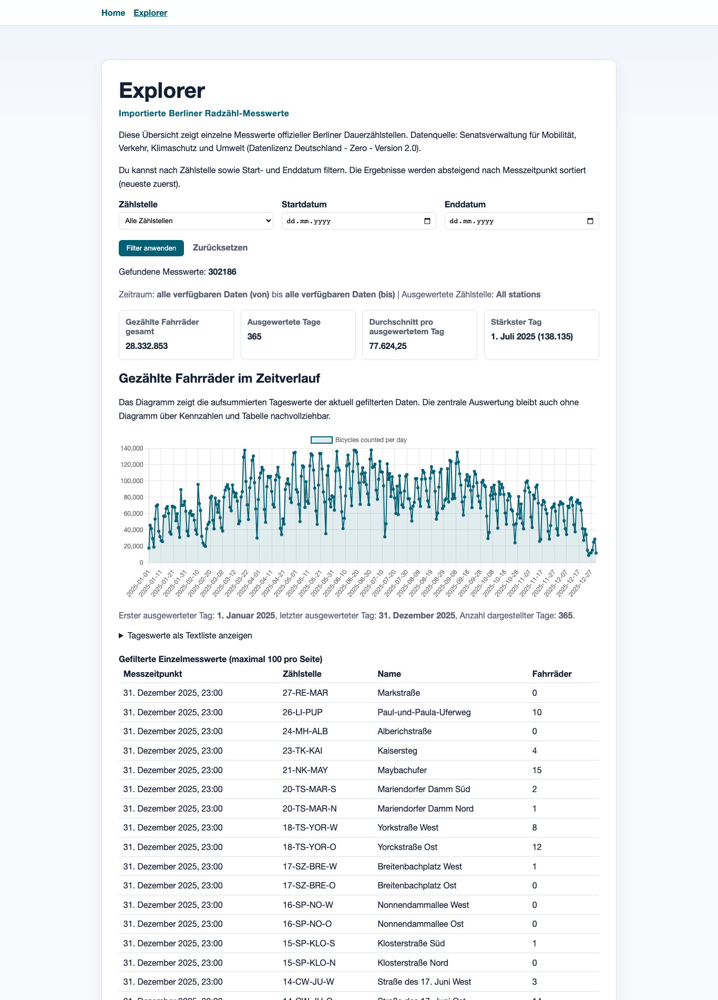
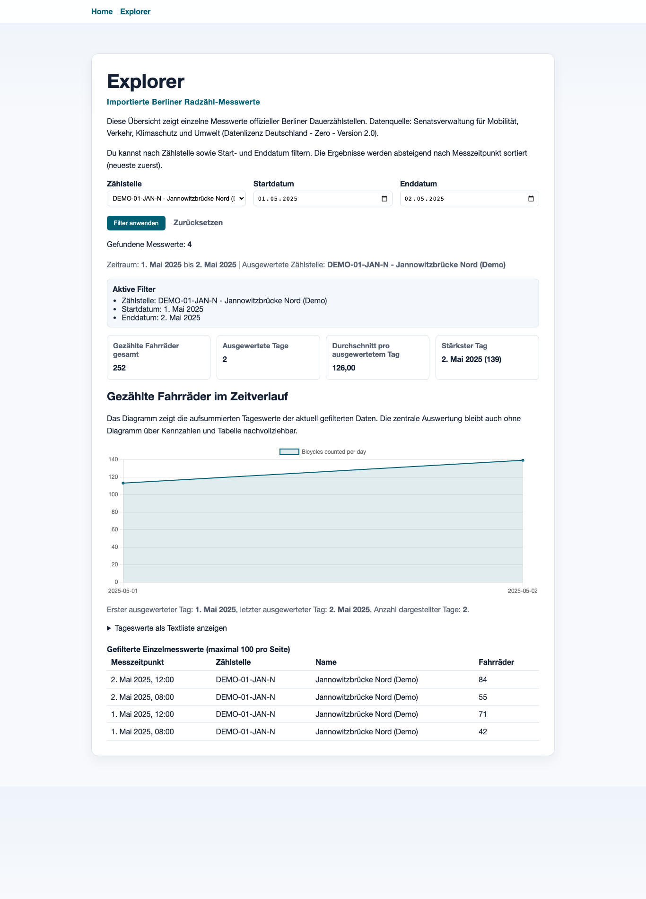

# BerlinBikeCountExplorer

BerlinBikeCountExplorer ist eine Ruby-on-Rails-Anwendung zur Auswertung offizieller Berliner Radzähldaten und historischer Wetterdaten (DWD): CSV-/Text-Import, serverseitige Filterung, tabellarische Anzeige, Kennzahlen und Zeitreihen-Diagramm.

## 1) Screenshot

Explorer (lokale Demoansicht, ungefiltert):



Explorer (lokale Demoansicht, Zeitraum-Filter, Tabelle exemplarisch mit wenigen Treffern):



## 2) Live-Demo

- Live-Demo: https://berlin-bike-count-explorer.onrender.com/explorer
- Hinweis: Die Instanz läuft auf Render.com Free Tier. Nach Inaktivität kann ein Cold Start von bis zu ca. 1 Minute auftreten, bevor die App sichtbar ist.

## 3) Problemstellung und Nutzen

Die offiziellen Berliner Radzähldaten liegen als große Rohdateien vor. Das Projekt zeigt, wie diese Daten robust importiert, in PostgreSQL modelliert und für eine nachvollziehbare Analyseoberfläche aufbereitet werden können.

## 4) Funktionsumfang

- Import normalisierter CSV-Dateien in PostgreSQL
- Duplikatsschutz und zeilenweise Fehlerbehandlung beim Import
- Explorer mit URL-basierten Filtern (`station_ids[]`, `from`, `to`, `page`; `station_id` bleibt kompatibel)
- Paginierte Ergebnistabelle
- SQL-basierte Kennzahlen:
  - Gesamtzahl
  - Durchschnitt pro ausgewertetem Tag
  - Stärkster Tag
  - Anzahl ausgewerteter Tage
- Chart.js-Liniendiagramm auf Tagesaggregation
- Importhistorie über `ImportBatch`
- DWD-Wetterimport (Tagesmitteltemperatur `TMK`, Niederschlag `RSK`)
- Kombinierte Tagesdaten (Rad + Wetter) über Kalenderdatum
- Wetteranalyse im Explorer:
  - Scatterplot Temperatur ↔ Radverkehr
  - Scatterplot Niederschlag ↔ Radverkehr
  - Pearson-Korrelation je Beziehung (bei unzureichenden Daten als „Nicht ausreichend Daten“)

## 5) Verwendete Technologien

- Ruby 4.0.6
- Rails 8.1.x
- PostgreSQL 16
- Minitest (inkl. Systemtest mit Rack::Test)
- Chart.js (via Importmap)
- RuboCop, Brakeman, Bundler Audit
- Dockerfile + Render Blueprint (`render.yaml`)

## 6) Datenquelle und Lizenz

- Datensatz: **Radzahldaten in Berlin**
- Veröffentlichende Stelle: Senatsverwaltung für Mobilität, Verkehr, Klimaschutz und Umwelt
- Portal: https://daten.berlin.de/datensaetze/radzahldaten-in-berlin
- Lizenz: **Datenlizenz Deutschland - Zero - Version 2.0 (dl-de-zero-2.0)**
- Detailanalyse der realen Quellstruktur: `docs/data_source_analysis.md`

### Zweite Datenquelle: Wetter (DWD)

- Quelle: Deutscher Wetterdienst (DWD), Climate Data Center (CDC)
- Produkt: tägliche Klimabeobachtungen (`daily/kl`)
- Verwendete Wetterstation für Berlin: `00433` – **Berlin-Tempelhof**
- Station laut DWD-Stationstabelle verfügbar von `19480101` bis aktuell laufend, für BBC-X genutzt im Rad-Daten-Zeitraum
- Konkrete Datei (historisch): `tageswerte_KL_00433_19480101_20251231_hist.zip`
- Relevante Felder:
  - `MESS_DATUM` (Datum, Format `YYYYMMDD`)
  - `TMK` (Tagesmitteltemperatur in °C)
  - `RSK` (Tagesniederschlag in mm)
- Fehlwerte: DWD kennzeichnet fehlende Werte mit `-999` (werden als `nil` gespeichert, nicht als `0`)
- Lizenz: DWD Open Data (CDC), frei zugängliche amtliche Wetterdaten

## 7) Architekturübersicht

```text
Offizielle XLSX/CSV-Quelle
  -> Normalisierung (XlsxNormalizer, optional)
  -> CsvImporter / ImportRunner
  -> DWD-Datei (ZIP/TXT) -> Weather::DwdImporter
  -> PostgreSQL (counting_stations, bike_counts, weather_stations, weather_observations, import_batches)
  -> Active Record Query Objects (FilterQuery, Statistics, WeatherAnalysis)
  -> Rails Controller + Views
  -> HTML-Tabelle + Kennzahlen + Chart.js
```

## 8) Datenmodell

### counting_stations

- `external_id` (unique)
- `name`
- `latitude` (optional)
- `longitude` (optional)
- `installed_at` (optional)

### bike_counts

- `counting_station_id` (FK)
- `counted_at`
- `count`
- Unique-Index auf `(counting_station_id, counted_at)`
- Zusatzindex auf `counted_at` für Datumsfilter/Aggregation

### import_batches

- `filename`
- `imported_at`
- `rows_read`
- `imported_rows`
- `skipped_duplicates`
- `invalid_rows`
- `status` (`running`, `completed`, `completed_with_errors`, `failed`)

### weather_stations

- `external_id` (DWD Stations-ID, unique)
- `name`

### weather_observations

- `weather_station_id` (FK)
- `observed_on` (Datum)
- `mean_temperature` (°C, nullable bei DWD-Fehlwert)
- `precipitation` (mm, nullable bei DWD-Fehlwert)
- Unique-Index auf `(weather_station_id, observed_on)`

## 9) CSV-Importprozess

1. Datei- und Header-Validierung
2. Zeilenweises Parsing und fachliche Validierung
3. Station anlegen/finden (`external_id`)
4. `bike_counts` per `insert_all` importieren
5. Duplikate über DB-Unique-Index erkennen
6. Importzusammenfassung + Fehlerliste erzeugen
7. Importlauf in `import_batches` protokollieren

## 9b) DWD-Importprozess (Wetter)

1. DWD Produktdatei lokal bereitstellen (ZIP oder TXT)
2. `Weather::DwdImporter` liest `MESS_DATUM`, `TMK`, `RSK`
3. Fehlwerte (`-999`) werden zu `nil` (nicht zu `0`)
4. Pro Datum wird maximal eine Beobachtung je Wetterstation gespeichert
5. Duplikate werden per Unique-Index erkannt und übersprungen
6. Strukturierte Importzusammenfassung wird ausgegeben

## 10) Filter- und Analysefunktionen

- Filterung erfolgt serverseitig in SQL, nicht in Ruby-Arrays.
- Alle Explorer-Bereiche nutzen dieselbe gefilterte Relation:
  - Tabelle
  - Trefferanzahl
  - Kennzahlen
  - Chartdaten
- Tagesaggregation: erst Summe pro Kalendertag, dann Kennzahlen.
- Wetterzuordnung erfolgt ohne FK zwischen BikeCount und Wetter:
  - `DATE(bike_counts.counted_at)` wird mit `weather_observations.observed_on` verbunden.

## 10b) Weather analysis

- Datenbasis: tägliche Rad-Summen + DWD-Tageswerte (`TMK`, `RSK`) auf demselben Kalenderdatum.
- Visualisierung: zwei Scatterplots im Explorer, je Punkt genau ein Kalendertag.
- Temperatur-Plot verwendet `TMK` auf der X-Achse, Niederschlags-Plot `RSK`.
- Tage ohne BikeCount werden nicht dargestellt.
- Tage ohne Temperatur erscheinen nur nicht im Temperatur-Plot; Tage ohne Niederschlag nur nicht im Niederschlags-Plot.
- Ein Messwert von `0` (z. B. `0 °C` oder `0 mm`) bleibt gültig und wird angezeigt.
- Korrelation: Pearson-Koeffizient wird serverseitig berechnet und neben jedem Plot ausgewiesen.
- Fachhinweis: Korrelation beschreibt einen Zusammenhang in Beobachtungsdaten und beweist keine Kausalität.

## 10c) External events

- In allen drei Visualisierungen werden BVG-Warnstreiktage 2025 mit einem Dreiecksmarker (`△`) markiert.
- Betroffen waren an diesen Tagen U-Bahn, Straßenbahn und die meisten Buslinien; S-Bahn und Regionalverkehr waren nicht Teil dieser BVG-Streiks.
- Die Markierung dient als Kontext für mögliche externe Einflussfaktoren und entfernt keine Datenpunkte aus der Analyse.
- Korrelationen bleiben unverändert und enthalten weiterhin alle gültigen Beobachtungstage.
- Die Markierung zeigt keinen kausalen Nachweis, sondern einen zeitlichen Kontext.
- Verwendete Kalendertage:
  - `2025-01-27`
  - `2025-02-10`
  - `2025-02-20`
  - `2025-02-21`
  - `2025-03-19`
  - `2025-03-20`
  - `2025-03-26`
  - `2025-03-27`
- Konfiguration zentral in `config/bvg_strike_days.yml`.
- Quelle: offizielle BVG-Dokumentation zur Tarifrunde 2025.

## 11) Lokale Einrichtung

Bevorzugter Weg:

```bash
cd BerlinBikeCountExplorer
bin/setup --skip-server
bin/rails db:seed
bin/rails server
```

Alternativ manuell:

```bash
bundle install
bin/rails db:prepare
```

Dann:

- Startseite: `http://localhost:3000`
- Explorer: `http://localhost:3000/explorer`

## 12) Erforderliche Umgebungsvariablen

### Lokal (optional)

- `RAILS_MAX_THREADS` (Default 5 in DB-Konfiguration)

### Produktion (relevant)

- `RAILS_ENV=production`
- `RAILS_MASTER_KEY`
- `DATABASE_URL` (Pflicht, z. B. Render Postgres oder externer Anbieter)
- `RAILS_FORCE_SSL=true` (empfohlen)
- `RAILS_ASSUME_SSL=true` (hinter SSL-terminierendem Proxy)
- `RAILS_ALLOWED_HOSTS=example.com,www.example.com` (optional auf Render, da `RENDER_EXTERNAL_HOSTNAME` automatisch berücksichtigt wird)
- `RAILS_LOG_LEVEL=info` (Default)

## 13) Datenbankanlage und Migrationen

```bash
bin/rails db:create
bin/rails db:migrate
```

oder kombiniert:

```bash
bin/rails db:prepare
```

## 14) Importbefehle

Normalisierung der offiziellen XLSX (optional):

```bash
bin/rails "bbcx:normalize_xlsx[data/raw/gesamtdatei-stundenwerte.xlsx,2025,data/raw/bbcx_normalized_2025.csv]"
```

CSV-Import:

```bash
bin/rails "bbcx:import[data/raw/bbcx_normalized_2025.csv]"
```

Produktions-Import über Supabase/Render-Zugangsdaten aus 1Password:

```bash
bin/import_production_csv data/raw/bbcx_normalized_2025.csv
```

Normalisieren + Import in einem Schritt:

```bash
bin/rails "bbcx:normalize_and_import[data/raw/gesamtdatei-stundenwerte.xlsx,2025,data/raw/bbcx_normalized_2025.csv]"
```

Reproduzierbare Demodaten:

```bash
bin/rails bbcx:seed_demo
```

DWD-Wetterimport:

```bash
bin/rails "weather:import[data/raw/tageswerte_KL_00433_19480101_20251231_hist.zip]"
```

## 15) Testbefehle

```bash
bin/rails test
bin/rails test test/system
bin/rails test test/services/bike_counts/csv_importer_test.rb
bin/rails test test/queries/bike_counts/statistics_test.rb
```

## 16) Qualitäts- und Sicherheitsprüfungen

```bash
bin/rubocop
bin/brakeman -q
bin/bundler-audit
bin/importmap audit
```

Kombinierter CI-Ablauf:

```bash
bin/ci
```

## 17) Produktionsfähigkeit / Konfiguration

- Produktions-Rails-Konfiguration vorhanden (`config/environments/production.rb`)
- Healthcheck-Route vorhanden: `GET /up`
- Asset-Precompile über Dockerfile und Rails-Task vorbereitet
- Secrets sind von Git getrennt (`config/*.key` ignoriert)
- `.gitignore` schließt lokale Rohdaten (`data/raw/*`) und lokale Gem-Installationen (`vendor/bundle`) aus
- Fehlermeldungen im Import zeigen keine internen Dateisystempfade

## 18) Deployment

Für ein kostenloses CV-Demo-Hosting ist **Render** vorbereitet:

- Blueprint-Datei: `render.yaml`
- Runtime: Docker (nutzt vorhandenes `Dockerfile`)
- Healthcheck: `/up`
- Infrastruktur reduziert:
  - keine Redis-Pflicht (Action Cable läuft in Produktion mit `async`)
  - Single-Postgres-Setup möglich (alle DB-Rollen können auf `DATABASE_URL` fallen)

## 19) Bekannte Einschränkungen

- Keine Mehrjahres-/Wochentagsanalyse.
- Keine Kartenansicht.
- Keine Upload-Oberfläche für Imports (nur Rake-Tasks).
- `import_batches` wird aktuell nicht in einer eigenen UI dargestellt.

## 20) Mögliche Erweiterungen

- Vergleich mehrerer Zählstellen
- weitere Zeitfilter (z. B. Wochentage)
- erweiterte Importhistorie als Admin-Ansicht
- weitere Diagrammtypen
- Produktionsspeicher für Active Storage (statt lokal)
